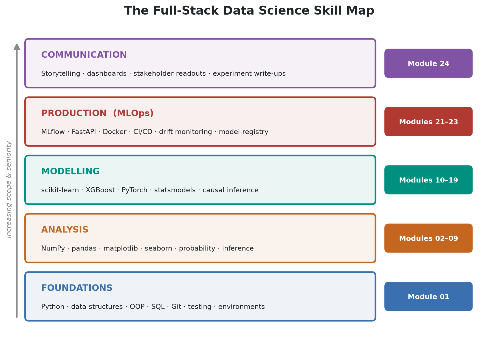
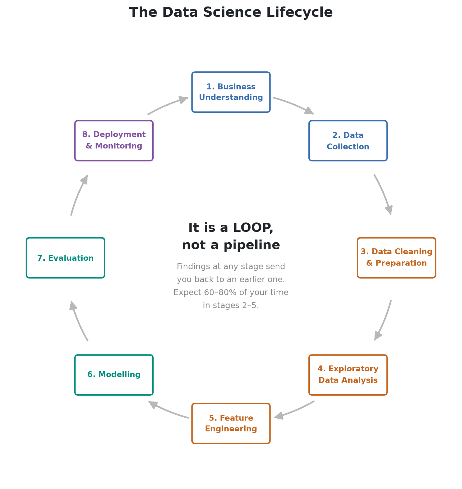
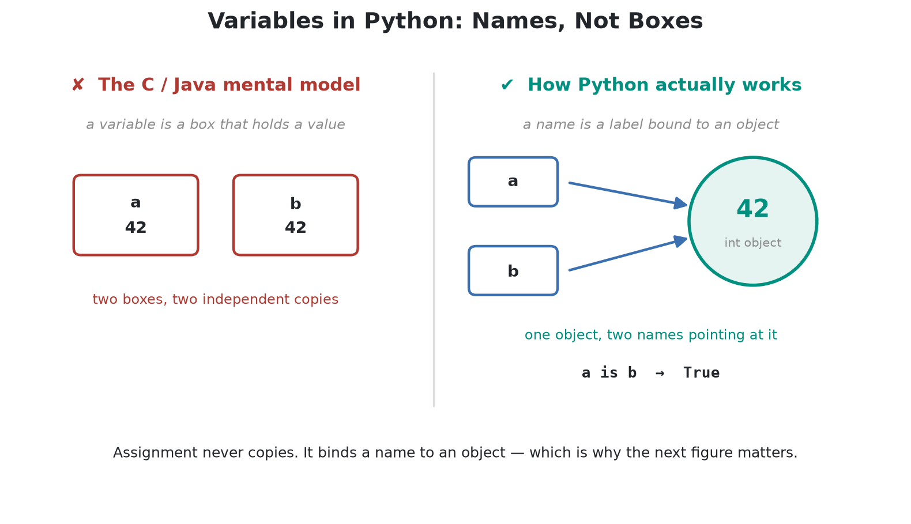
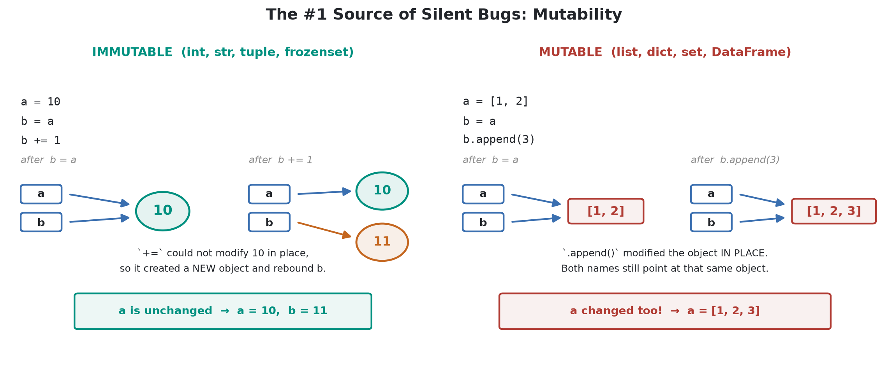
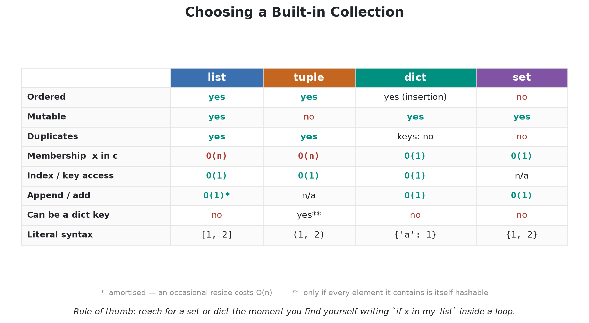
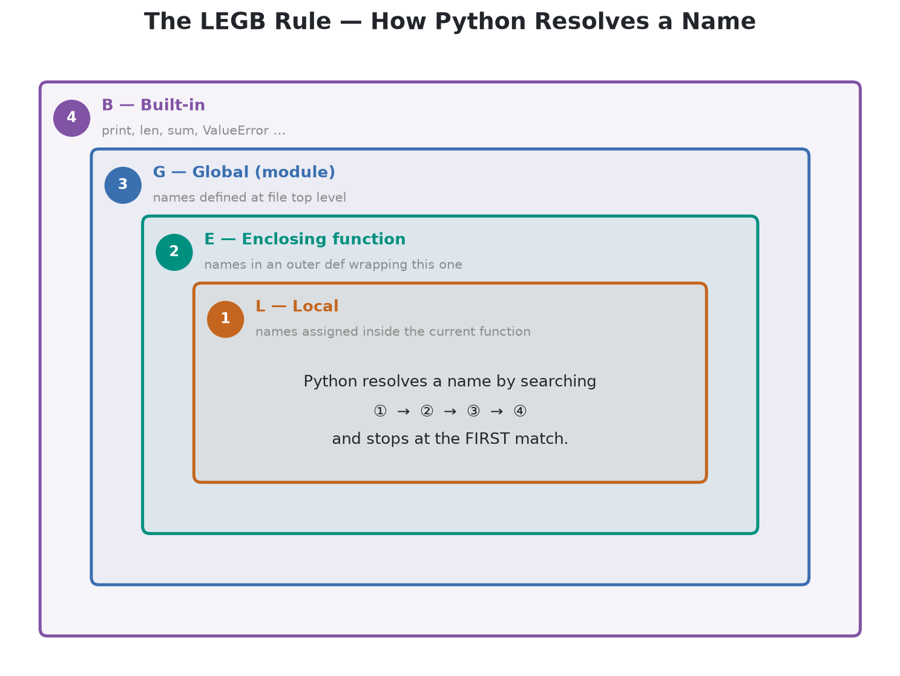
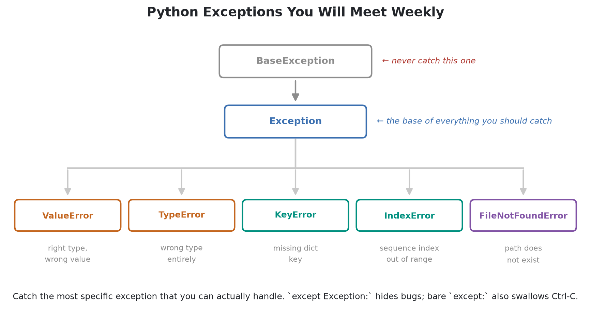

# Module 01 — Python Foundations for Data Science

> **Part I — Foundations** · Estimated time: **8–10 hours** · Prerequisites: none

This module builds the Python layer that everything else in the course sits on.
It is deliberately *not* a generic "learn Python" tutorial: every topic is chosen
because it shows up in real data science work, and the examples are drawn from
data problems rather than from toy exercises.

  

---

## Why this module exists

Most people arriving at data science can already write *some* Python. What
separates them from a professional is rarely syntax — it is the set of habits
below. Skipping this module is the single most common reason people later write
notebooks that produce silently wrong numbers.

| The habit | What it prevents |
| :--- | :--- |
| Understanding names vs. objects | Mutating a DataFrame you thought you had copied |
| Knowing your collection's complexity | A `for` loop that takes 40 minutes instead of 2 seconds |
| Comprehensions & generators | Loading a 20 GB file into memory at once |
| Writing functions, not scripts | Copy-pasted analysis logic that drifts out of sync |
| Handling errors deliberately | A pipeline that swallows failures and reports garbage |
| Testing your transformations | Shipping a feature-engineering bug to production |

---

## Learning objectives

By the end of this module you will be able to:

1. **Set up and reproduce** a professional Python environment (virtual env, kernel, dependency pinning).
2. **Explain Python's object model** — names, references, mutability — and predict aliasing behaviour.
3. **Choose the right built-in collection** for a task based on its time complexity.
4. **Write idiomatic transformations** using comprehensions, generators, and the functional built-ins.
5. **Design reusable functions** with sane signatures, type hints, and docstrings.
6. **Model data with classes**, including `dataclass`es and the scikit-learn estimator pattern.
7. **Read and write** CSV, JSON, and Parquet safely with `pathlib` and context managers.
8. **Handle errors and log** in a way that makes a failing pipeline diagnosable.
9. **Test data transformations** with `pytest` so refactors stay safe.

---

## Companion book

📘 **[`pdf/01-python-foundations.pdf`](pdf/01-python-foundations.pdf)**: the illustrated companion to this module.
Every concept from the notebooks below, in a lighter voice, with diagrams and
short true stories from the history of data science. Read it alongside the
notebooks or on its own, away from the keyboard.

---

## Notebooks

Work through them in order — each builds on the last.

| # | Notebook | What you will learn | Time |
| :-: | :--- | :--- | :-: |
| 01 | [Course Introduction & Setup](notebooks/01_course_introduction_and_setup.ipynb) | The DS lifecycle, the role, the tooling, environment reproducibility, notebook workflow | 60 min |
| 02 | [Python Fundamentals](notebooks/02_python_fundamentals.ipynb) | The object model, types, numeric traps, strings, control flow, truthiness | 90 min |
| 03 | [Data Structures](notebooks/03_data_structures.ipynb) | list / tuple / dict / set, complexity, `collections`, comprehensions | 90 min |
| 04 | [Functions & Functional Programming](notebooks/04_functions_and_functional_programming.ipynb) | Signatures, scope, closures, decorators, generators, `map`/`filter` | 90 min |
| 05 | [Object-Oriented Programming](notebooks/05_object_oriented_programming.ipynb) | Classes, dunder methods, `dataclass`, inheritance vs. composition, the estimator pattern | 75 min |
| 06 | [Files & Data Formats](notebooks/06_files_and_data_formats.ipynb) | `pathlib`, context managers, CSV / JSON / Parquet, encodings, format trade-offs | 75 min |
| 07 | [Errors, Logging & Testing](notebooks/07_errors_logging_and_testing.ipynb) | Exceptions, custom errors, logging, assertions, `pytest`, data validation | 90 min |
| 08 | [Module Project](notebooks/08_module_project.ipynb) | Build a small, tested ETL + reporting pipeline using everything above | 120 min |
| 09 | [Exercise Solutions](notebooks/09_exercise_solutions.ipynb) | Worked answers with reasoning — **open only after attempting the exercises** | — |

---

## Key figures

The diagrams below are referenced from the notebooks. They are generated by
[`scripts/generate_figures.py`](../../scripts/generate_figures.py) — regenerate
them any time with `.venv/bin/python scripts/generate_figures.py`.

| Figure | Notebook |
| :--- | :--- |
|  | 01 |
|  | 02 |
|  | 02 |
|  | 03 |
|  | 04 |
|  | 07 |

---

## Exercises

Each notebook ends with exercises. [`exercises/README.md`](exercises/README.md)
indexes all 29 of them; the worked solutions are in
[notebook 09](notebooks/09_exercise_solutions.ipynb).

> **Do the exercises before reading the solutions.** Reading a solution feels
> like learning and is not.

---

## Self-assessment checklist

You are ready for Module 02 when you can answer all of these *without looking
them up*:

- [ ] Why does `b = a` then `b.append(1)` sometimes change `a`, and sometimes not?
- [ ] Why is `0.1 + 0.2 == 0.3` `False`, and what should you write instead?
- [ ] Why is `x in my_set` faster than `x in my_list`, and by how much?
- [ ] What is the difference between a list comprehension and a generator expression?
- [ ] What does a mutable default argument (`def f(x=[])`) do, and why is it a bug?
- [ ] When would you use `@dataclass` instead of writing `__init__` yourself?
- [ ] Why is `except Exception:` usually wrong?
- [ ] Why should a data pipeline use `logging` rather than `print`?
- [ ] What makes Parquet a better choice than CSV for a 5 GB dataset?

---

## Further reading

| Resource | Why it is worth your time |
| :--- | :--- |
| [Fluent Python, 2nd ed.](https://www.oreilly.com/library/view/fluent-python-2nd/9781492056348/) (Ramalho) | The definitive book on Python's object model — chapters 1–3 map directly onto notebooks 02–03. |
| [PEP 8](https://peps.python.org/pep-0008/) | The style guide every Python codebase assumes you have read. |
| [PEP 484](https://peps.python.org/pep-0484/) | Type hints, used throughout `src/dstoolkit/`. |
| [Python `collections` docs](https://docs.python.org/3/library/collections.html) | `Counter` and `defaultdict` alone will save you hundreds of lines. |
| [TimeComplexity wiki](https://wiki.python.org/moin/TimeComplexity) | The complexity table for every built-in operation. |

---

**Next:** Module 02 — NumPy & Numerical Computing.
