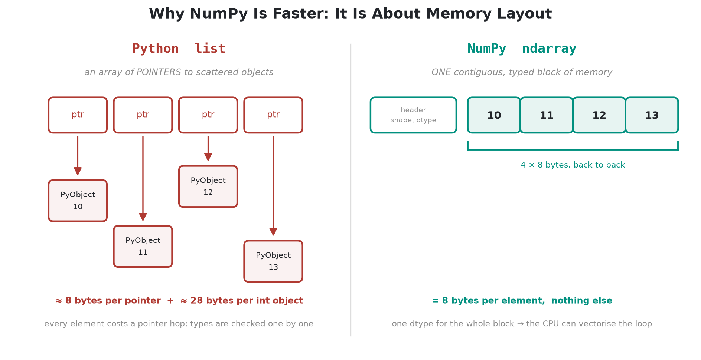
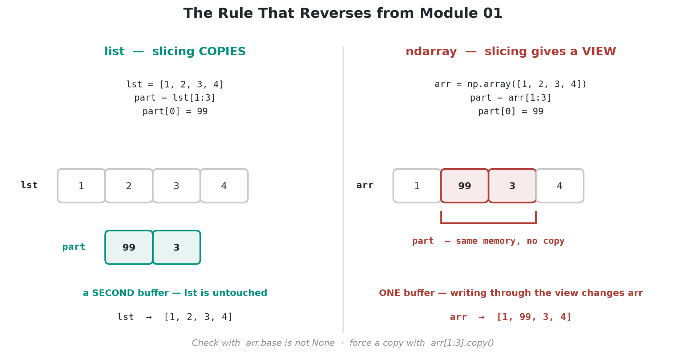
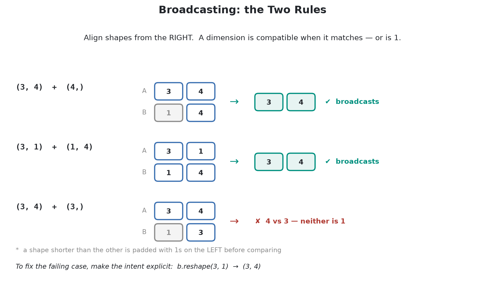
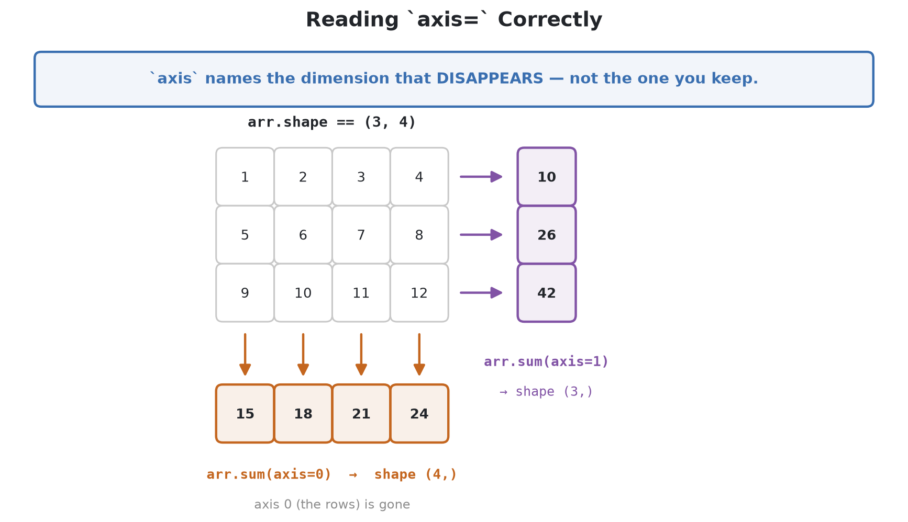

# Module 02 — NumPy & Numerical Computing

> **Part I — Foundations** · Estimated time: **10–13 hours** · Prerequisites: [Module 01](../01-python-foundations/)

Every numerical library in this course — pandas, scikit-learn, statsmodels,
SciPy, PyTorch — is a layer on top of the ndarray. This module is where you stop
treating that layer as magic. You will learn *why* vectorised code is fast, not
just that it is, and you will finish by implementing linear regression and
k-means from nothing but NumPy.

  

---

## Why this module exists

Module 01 taught you to write correct Python. That is not enough: correct Python
that loops over 10 million rows is unusable, and NumPy code that *looks* correct
can be silently wrong in ways a `for` loop never is.

| The habit | What it prevents |
| :--- | :--- |
| Thinking in whole arrays | A 40-minute loop where a 2-second expression would do |
| Knowing views from copies | Mutating an array through a slice you thought was yours |
| Choosing dtypes deliberately | An `int32` counter that silently wraps to a negative number |
| Reading a shape before trusting a result | A `(1000,) + (1000,1)` broadcast that returns a million-element bug |
| Understanding `axis=` | Standardising by the wrong dimension and never noticing |
| Solving rather than inverting | Coefficients destroyed by an ill-conditioned matrix |
| Seeding a `Generator`, not the global state | Results nobody — including you — can reproduce |

---

## Learning objectives

By the end of this module you will be able to:

1. **Explain the performance gap** between a Python list and an ndarray in terms of memory layout, and measure it yourself.
2. **Create, index, reshape, and combine** arrays in N dimensions, and predict whether an operation returns a view or a copy.
3. **Choose dtypes deliberately**, anticipating integer overflow, type promotion, and `float32` precision limits.
4. **Apply the two broadcasting rules** to align shapes on purpose, and recognise shapes that broadcast into the wrong answer.
5. **Reduce along any axis** and replace conditional loops with boolean masks, `np.where`, and fancy indexing.
6. **Use linear algebra correctly** — `solve` and `lstsq` over `inv`, eigendecomposition, SVD — and read a condition number.
7. **Simulate and bootstrap** with the modern `Generator` API, with reproducibility that survives parallelism.
8. **Diagnose performance and memory** through strides, temporaries, and memory-mapped arrays — and know when NumPy has run out of road.
9. **Implement a real algorithm from scratch** to the scikit-learn estimator contract.

---

## Companion book

📘 **[`pdf/02-numpy-numerical-computing.pdf`](pdf/02-numpy-numerical-computing.pdf)**: the illustrated companion to this module.
Every concept from the notebooks below, in a lighter voice, with diagrams and
short true stories from the history of data science. Read it alongside the
notebooks or on its own, away from the keyboard.

---

## Notebooks

Work through them in order — each builds on the last.

| # | Notebook | What you will learn | Time |
| :-: | :--- | :--- | :-: |
| 01 | [Why NumPy Exists](notebooks/01_why_numpy_exists.ipynb) | Memory layout, what "vectorised" really means, ufuncs, measuring the gap, when *not* to use NumPy | 60 min |
| 02 | [ndarray Fundamentals](notebooks/02_ndarray_fundamentals.ipynb) | Creation, `shape`/`ndim`/`size`/`dtype`, N-d indexing, **views vs copies**, reshaping, stacking | 90 min |
| 03 | [Dtypes & Numerical Precision](notebooks/03_dtypes_and_precision.ipynb) | The dtype zoo, silent overflow, promotion in NumPy 2.0, `float32` trade-offs, epsilon, `NaN`/`inf`, downcasting | 75 min |
| 04 | [Broadcasting](notebooks/04_broadcasting.ipynb) | The two rules, reading the error, `np.newaxis`, the silent bug, standardisation & pairwise distances, the memory trap | 75 min |
| 05 | [Aggregations & Boolean Masking](notebooks/05_aggregations_and_masking.ipynb) | `axis=` demystified, `keepdims`, masks, `where`/`select`/`clip`, fancy indexing, `unique`/`bincount`/`histogram` | 90 min |
| 06 | [Linear Algebra](notebooks/06_linear_algebra.ipynb) | Dot products & norms, `@` vs `*`, solving systems, least squares, eigenvalues, SVD, condition numbers | 90 min |
| 07 | [Randomness & Simulation](notebooks/07_random_and_simulation.ipynb) | The `Generator` API, `SeedSequence`/`spawn`, distributions, sampling, Monte Carlo, the bootstrap | 75 min |
| 08 | [Performance & Memory](notebooks/08_performance_and_memory.ipynb) | Strides, C vs Fortran order, in-place ops, honest memory measurement, `np.memmap`, choosing the right tool | 75 min |
| 09 | [Module Project](notebooks/09_module_project.ipynb) | Linear regression **and** k-means from scratch, to the sklearn estimator contract | 120 min |
| 10 | [Exercise Solutions](notebooks/10_exercise_solutions.ipynb) | Worked answers with reasoning — **open only after attempting the exercises** | — |

---

## Key figures

The diagrams below are referenced from the notebooks. They are generated by
[`scripts/generate_figures.py`](../../scripts/generate_figures.py) — regenerate
them any time with `.venv/bin/python scripts/generate_figures.py`.

| Figure | Notebook |
| :--- | :--- |
|  | 01 |
|  | 02 |
|  | 04 |
|  | 05 |

---

## Exercises

Each of notebooks 01–08 ends with five exercises.
[`exercises/README.md`](exercises/README.md) indexes all 40 of them; the worked
solutions are in [notebook 10](notebooks/10_exercise_solutions.ipynb). The
project adds six open-ended extensions on top.

> **Do the exercises before reading the solutions.** Reading a solution feels
> like learning and is not.

---

## The three traps this module exists to prevent

If you remember nothing else, remember these. Each has a notebook devoted to it
because each produces *wrong numbers rather than an exception*.

1. **A slice is a view.** `arr[1:3] = 0` writes into the original array. Lists
   copy on slice; arrays do not. Notebook 02.
2. **Integers wrap silently.** `np.int32` arithmetic that exceeds 2 147 483 647
   does not raise — it goes negative. Notebook 03.
3. **`(n,)` and `(n, 1)` broadcast to `(n, n)`.** No error, an answer of the
   wrong shape, and a mean over the wrong dimension. Notebook 04.

---

## Self-assessment checklist

You are ready for Module 03 when you can answer all of these *without looking
them up*:

- [ ] Why is a Python list of numbers slower *and* larger than an ndarray?
- [ ] Why does `arr[1:3]` behave differently from `lst[1:3]`?
- [ ] What does `axis=0` actually collapse?
- [ ] When does `keepdims=True` matter, and what breaks without it?
- [ ] What are the two broadcasting rules?
- [ ] Why does `int32_arr.sum()` not overflow but `int32_arr * 400` does?
- [ ] Why should you never call `np.linalg.inv` to solve a system?
- [ ] What does a condition number of 1e16 tell you?
- [ ] Why is `np.random.seed` a poor choice for reproducibility?
- [ ] What are strides, and why is `arr.T` free?

---

## Further reading

| Resource | Why it is worth your time |
| :--- | :--- |
| [NumPy: the absolute basics for beginners](https://numpy.org/doc/stable/user/absolute_beginners.html) | The official tour; a fast second pass over notebooks 01–02. |
| [Array programming with NumPy](https://www.nature.com/articles/s41586-020-2649-2) (Harris et al., *Nature* 2020) | The paper by the maintainers — the clearest account of *why* the design is what it is. |
| [NumPy broadcasting docs](https://numpy.org/doc/stable/user/basics.broadcasting.html) | The rules stated formally, with the shape table worth memorising. |
| [What Every Computer Scientist Should Know About Floating-Point](https://docs.oracle.com/cd/E19957-01/806-3568/ncg_goldberg.html) (Goldberg) | The reference behind notebook 03. Dense, and worth it. |
| [NumPy random sampling guide](https://numpy.org/doc/stable/reference/random/index.html) | Why `Generator` replaced `RandomState`, and how `SeedSequence` works. |
| [Introduction to Linear Algebra](https://math.mit.edu/~gs/linearalgebra/) (Strang) | If notebook 06 felt thin, this is the book to read alongside Modules 11–19. |

---

**Next:** Module 03 — pandas & Data Wrangling.
